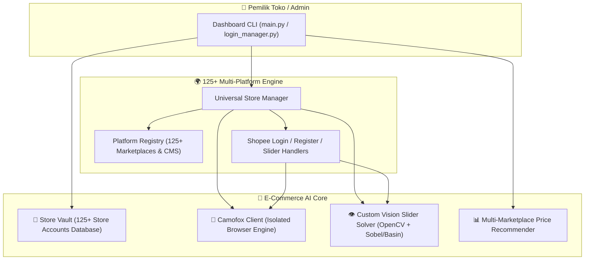

# 🛒 E-Commerce AI — Autonomous Store Manager & 125+ Multi-Store Swarm Agent

> **Status Proyek:** 🚧 *Work in Progress (Under Active Development)*

**E-Commerce AI** adalah sistem agen otomatis berskala besar yang dirancang untuk mengelola operasional **125+ akun toko** lintas **125+ platform marketplace & e-commerce** (Indonesia, Asia Tenggara, Asia Timur, Amerika, Eropa, Timur Tengah, hingga CMS Storefront) menggunakan isolasi sesi browser anti-deteksi (**Camofox**) dan modul Computer Vision buatan sendiri.

---

## 🏛️ Arsitektur Sistem



---

## 🌍 Dukungan 125+ Platform E-Commerce & Marketplace

Sistem ini telah dilengkapi katalog **`PLATFORM_REGISTRY`** (`platforms/registry.py` & `config.json`) yang mencakup **125 platform** di seluruh dunia:

1. **🇮🇩 Indonesia Marketplaces, B2B & Quick Commerce (30 Platform):**
   * Shopee Indonesia, Tokopedia, TikTok Shop Indonesia, Lazada Indonesia, Blibli, Bukalapak, Zalora Indonesia, Sociolla, Bhinneka, Jakmall, Ralali B2B, Indotrading, KlikIndomaret, Alfagift, GoBiz (GoFood/GoMart), GrabMerchant (GrabFood/GrabMart), Ruparupa, Dekoruma, Matahari.com, Eraspace, iBox Indonesia, Digimap, Gramedia, Periplus, Sayurbox, Segari, Astro, DatascripMall, Pawoon, Majoo.
2. **🌏 Southeast Asia & East Asia Marketplaces (35 Platform):**
   * Shopee (SG, MY, TH, PH, VN, TW), Lazada (SG, MY, TH, PH, VN), Carousell (SG, MY), Qoo10 SG, Zalora (SG, MY), Tiki VN, Sendo VN, PG Mall MY, Taobao, Tmall, JD.com, Pinduoduo, AliExpress, Alibaba.com, 1688 Wholesale, Rakuten Ichiba JP, Mercari JP, Yahoo! Japan Shopping, ZOZOTOWN, Coupang KR, Gmarket KR, 11Street KR, Naver SmartStore, SSG.COM.
3. **🌐 Global, Americas, Europe, South Asia & MENA (40 Platform):**
   * Amazon (US, UK, DE, JP, SG), eBay Global, Walmart Marketplace, Target Plus, Best Buy, Etsy, Wayfair, Newegg, Temu, SHEIN, Wish, Overstock, Poshmark, Depop, StockX, GOAT, Flipkart, Myntra, Meesho, Nykaa, IndiaMART, Zalando, ASOS, OTTO Germany, Bol.com, Cdiscount, Fnac, Allegro Poland, Trendyol, Hepsiburada, Ozon, Wildberries, Noon MENA, Jumia Africa, Mercado Libre, Magazine Luiza.
4. **🛍️ Storefront CMS, Omnichannel & Social Commerce (20 Platform):**
   * Shopify, WooCommerce, Adobe Commerce (Magento), BigCommerce, PrestaShop, OpenCart, Wix eCommerce, Squarespace Commerce, Ecwid, SIRCLO, Desty Omni, Jubelio, Plugo, OrderOnline.id, Evermos, WhatsApp Business Catalog, Meta Commerce Manager (IG/FB Shop), Pinterest Business, YouTube Shopping, LINE MyShop.

---

## 🧩 Modul Utama yang Sudah Dibangun

### 1. 🔐 125+ Multi-Store Swarm Vault (`core/vault.py` & `store_vault.example.json`)
* Mengelola database **125+ akun toko** (`toko_001` s/d `toko_125`) yang terdistribusi di 125 platform e-commerce.
* Fitur *auto-seeding* 125 toko (`seed_125_stores`), filter per platform/region, serta isolasi sesi `user_id` dan `session_key` unik untuk setiap akun toko.

### 2. 🌐 Universal Store Session Manager (`platforms/universal_manager.py`)
* Membuka dan mengelola sesi Seller Center, halaman login, atau registrasi untuk akun toko mana pun dari 125+ platform yang terdaftar.
* Otomatis mendeteksi apabila muncul tantangan *slider puzzle* di layar dan mendelegasikannya ke modul `OpenCVCanvasSolver`.

### 3. 👁️ Custom Puzzle Slider Solver (`core/vision_solver.py` & `platforms/shopee_slider.py`)
Solver *in-house* eksperimental berbasis Computer Vision lokal yang dikembangkan sendiri untuk menangani tantangan *visual slider puzzle*:
* **DOM Relative Y Extraction:** Menghitung posisi vertikal kepingan langsung dari koordinat `getBoundingClientRect()` antara elemen `<canvas>` latar dan kepingan.
* **Alpha Cutout Margin Calibration (`xmin`):** Mengekstrak *alpha channel* kepingan puzzle untuk mengkompensasi margin transparan di sisi kiri kanvas.
* **Dark Basin & Sobel Vertical Gradient Profiling:** Menganalisis profil kontras bayangan lubang dan lonjakan gradien vertikal (Sobel) pada jalur luncur horizontal.
* **Humanized Hardware Drag (`core/camofox.py`):** Menggerakkan slider dengan kurva Bézier, *overshoot*, dan *pullback* terkalibrasi.

### 4. 📊 Smart Shopping & Price Recommender (`services/recommender.py`)
* Mesin penilaian (*scoring*) untuk menganalisis dan membandingkan harga produk, persentase diskon, rating toko, dan volume penjualan lintas marketplace.

---

## 📁 Struktur Direktori

```text
e-commerce-ai/
├── main.py                      # Dashboard utama Swarm Agent (125+ Toko & Platform)
├── login_manager.py             # Manajer khusus login & sesi multi-toko
├── config.json                  # Konfigurasi lengkap 125+ platform marketplace
├── store_vault.example.json     # Database 125 akun toko siap pakai (toko_001 - toko_125)
├── requirements.txt             # Dependensi Python (requests, opencv-python, numpy)
├── run_agent.bat                # Pintasan menjalankan main.py (Windows)
├── run_login_manager.bat        # Pintasan menjalankan login_manager.py
├── start_camofox.bat            # Pintasan menyalakan server Camofox (port 9377)
├── core/
│   ├── camofox.py               # Client REST API Camofox Browser
│   ├── vault.py                 # Manajer penyimpanan & generator 125+ akun toko
│   └── vision_solver.py         # Engine Computer Vision solver puzzle kanvas
├── platforms/
│   ├── registry.py              # Katalog metadata 125+ platform e-commerce dunia & ID
│   ├── universal_manager.py     # Pengelola sesi universal lintas 125+ platform
│   ├── shopee_login.py          # Alur login otomatis & verifikasi OTP Shopee
│   ├── shopee_register.py       # Alur registrasi & pengisian form React Shopee
│   └── shopee_slider.py         # Wrapper solver slider captcha
└── services/
    └── recommender.py           # Algoritma scoring & rekomendasi harga/produk
```

---

## 🚧 Catatan Pengembangan & Roadmap (To-Do)

Saat ini proyek masih dalam tahap pengembangan aktif dengan fokus berikutnya:
- [ ] **Upgrade AI Vision Solver (Multimodal LLM / Deep Vision):** Mengatasi keterbatasan deteksi piksel OpenCV pada gambar latar yang memiliki tekstur sangat ramai (misal: makanan/pemandangan kompleks) serta siluet objek melengkung dengan *decoy* (jebakan siluet ganda).
- [ ] **💬 Modul Auto CS & Chat Responder AI:** Membalas pesan pelanggan secara otomatis 24/7 lintas 125+ platform.
- [ ] **📦 Modul Order & Logistics Monitor:** Pemantauan pesanan masuk dan sinkronisasi resi pengiriman.
- [ ] **📝 Modul AI Product Listing & SEO Copywriter:** Pembuatan judul dan deskripsi produk otomatis yang teroptimasi untuk algoritma pencarian masing-masing marketplace.
