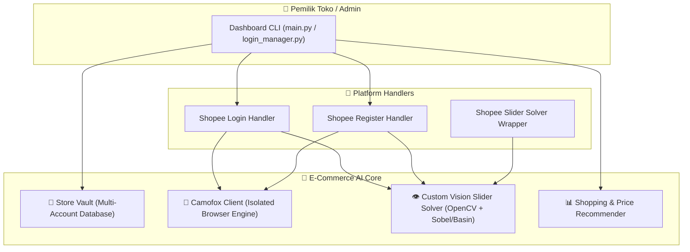

# 🛒 E-Commerce AI — Autonomous Store Manager & Multi-Account Swarm Agent

> **Status Proyek:** 🚧 *Work in Progress (Under Active Development)*

**E-Commerce AI** adalah sistem agen otomatis yang dirancang untuk mengelola operasional banyak akun toko di marketplace (Shopee, Tokopedia, dll.) secara terpusat menggunakan isolasi sesi browser anti-deteksi (**Camofox**) dan modul kecerdasan buatan.

---

## 🏛️ Arsitektur Sistem



---

## 🧩 Modul yang Sudah Dibangun

### 1. 🔐 Multi-Account Store Vault (`core/vault.py`)
* Menyimpan dan mengelola daftar akun toko (ID toko, nama toko, nomor HP, proxy, status login, serta ID tab sesi aktif).
* Mendukung isolasi sesi per toko (`user_id` dan `session_key` terpisah di Camofox).

### 2. 🦊 Camofox Stealth Browser Client (`core/camofox.py`)
* Integrasi REST API ke server **Camofox** (`http://localhost:9377`).
* Mendukung pembuatan tab terisolasi, navigasi, evaluasi DOM JavaScript, pengambilan *snapshot* aksesibilitas, *screenshot*, dan *hardware-level mouse drag* dengan kurva gerakan terkalibrasi (Bézier S-Curve & *overshoot pullback*).

### 3. 👁️ Custom Puzzle Slider Solver (`core/vision_solver.py` & `platforms/shopee_slider.py`)
Solver *in-house* eksperimental berbasis Computer Vision lokal yang dikembangkan sendiri untuk menangani tantangan *visual slider puzzle*:
* **DOM Relative Y Extraction:** Menghitung posisi vertikal kepingan langsung dari koordinat `getBoundingClientRect()` antara elemen `<canvas>` latar dan kepingan.
* **Alpha Cutout Margin Calibration (`xmin`):** Mengekstrak *alpha channel* kepingan puzzle untuk mengkompensasi margin transparan di sisi kiri kanvas.
* **Dark Basin & Sobel Vertical Gradient Profiling:** Menganalisis profil kontras bayangan lubang dan lonjakan gradien vertikal (Sobel) pada jalur luncur horizontal.
* **Multi-Attempt Auto-Calibration:** Percobaan ulang otomatis dengan penyesuaian *micro-offset* (`[0, +2, -2, +4, -3] px`) dan verifikasi status DOM.

### 4. 🏪 Platform Automation (`platforms/shopee_login.py` & `platforms/shopee_register.py`)
* Otomatisasi pengisian form nomor telepon menggunakan *React Native Value Setter* agar state input terdeteksi oleh framework frontend modern.
* Penanganan modal bahasa, pemicu pengiriman OTP (WhatsApp/SMS), dan injeksi 6 digit kode OTP ke form verifikasi.

### 5. 📊 Smart Shopping & Price Recommender (`services/recommender.py`)
* Mesin penilaian (*scoring*) untuk menganalisis dan membandingkan harga produk, persentase diskon, rating toko, volume penjualan, dan tipe penjual (*Official Store / Star Seller*).

---

## 📁 Struktur Direktori

```text
e-commerce-ai/
├── main.py                      # Dashboard utama operasional Swarm Agent
├── login_manager.py             # Manajer khusus login & sesi multi-toko
├── config.json                  # Konfigurasi endpoint Camofox & URL platform
├── store_vault.example.json     # Contoh skema database akun toko
├── requirements.txt             # Dependensi Python (requests, opencv-python, numpy)
├── run_agent.bat                # Pintasan menjalankan main.py (Windows)
├── run_login_manager.bat        # Pintasan menjalankan login_manager.py
├── start_camofox.bat            # Pintasan menyalakan server Camofox (port 9377)
├── core/
│   ├── camofox.py               # Client REST API Camofox Browser
│   ├── vault.py                 # Manajer penyimpanan akun & status toko
│   └── vision_solver.py         # Engine Computer Vision solver puzzle kanvas
├── platforms/
│   ├── shopee_login.py          # Alur login otomatis & verifikasi OTP
│   ├── shopee_register.py       # Alur registrasi & pengisian form React
│   └── shopee_slider.py         # Wrapper solver slider captcha
└── services/
    └── recommender.py           # Algoritma scoring & rekomendasi harga/produk
```

---

## 🚧 Catatan Pengembangan & Roadmap (To-Do)

Saat ini proyek masih dalam tahap pengembangan aktif dengan fokus berikutnya:
- [ ] **Upgrade AI Vision Solver (Multimodal LLM / Deep Vision):** Mengatasi keterbatasan deteksi piksel OpenCV pada gambar latar yang memiliki tekstur sangat ramai (misal: makanan/pemandangan kompleks) serta siluet objek melengkung dengan *decoy* (jebakan siluet ganda).
- [ ] **💬 Modul Auto CS & Chat Responder AI:** Membalas pesan pelanggan secara otomatis 24/7 (tanya stok, spesifikasi, komplain).
- [ ] **📦 Modul Order & Logistics Monitor:** Pemantauan pesanan masuk dan pengingat batas waktu pengiriman.
- [ ] **📝 Modul AI Product Listing & SEO Copywriter:** Pembuatan judul dan deskripsi produk otomatis yang teroptimasi untuk algoritma pencarian marketplace.

---

## 💻 Cara Menjalankan

1. **Instal Dependensi Python:**
   ```bash
   pip install -r requirements.txt
   ```
2. **Siapkan Konfigurasi Vault:**
   Salin `store_vault.example.json` menjadi `store_vault.json`.
3. **Nyalakan Server Camofox:**
   Jalankan `start_camofox.bat` (membutuhkan server Camofox aktif di port `9377`).
4. **Jalankan Agent:**
   ```bash
   py main.py
   ```
